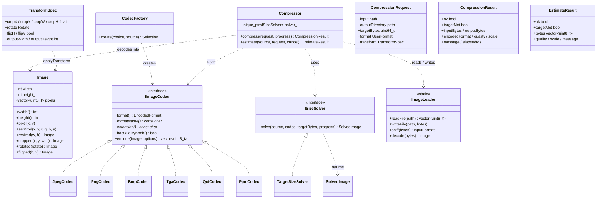

# PressPNG

**[⬇ Download the Windows build](https://github.com/UtkarshJoshiNtl/PressPNG/releases/latest)** (no install needed — just unzip and run `PressPNG.exe`)

A small desktop application that compresses an image to a **required target
file size** (for example "make this photo at most 500 KB"). Built with
object-oriented C++17, a Qt 6 desktop interface, and no external runtime
dependencies beyond Qt.

Two ways to use it:

- **GUI** (`PressPNG`): pick a file, choose a target size, format, and output
  location, compare the source against the compressed result with a wipe
  slider, crop/rotate/flip, then compress.
- **CLI** (`presspng-cli`): the same engine for scripts and testing.

The engine (`presspng_core`) is a plain C++17 library with no UI or Qt
dependency; both front ends sit on top of it.

## Requirements

- **CMake ≥ 3.16** and a **C++17 compiler** (Visual Studio 2019+, MinGW-w64,
  GCC, or Clang).
- **Qt 6 Widgets** for the GUI. If Qt is not found, CMake builds the core,
  CLI, and tests only, and prints a warning instead of failing.

## Building

```sh
cmake -S . -B build
cmake --build build --config Release
```

On Windows this produces `PressPNG.exe` (Qt GUI) and `presspng-cli.exe`. When
building with a Qt installation that is not on the default search path, pass
`-DCMAKE_PREFIX_PATH=/path/to/Qt/6.x.x/<kit>`.

Two CMake options control the front ends:

| Option | Default | Meaning |
|--------|---------|---------|
| `PRESSPNG_QT_GUI` | `ON` | Build the Qt 6 GUI target `PressPNG` |
| `PRESSPNG_WIN32_GUI` | `ON` | Build the legacy Win32 GUI as `PressPNG-win32` (Windows only) |

Run the test suite with `ctest --test-dir build` (or run `presspng-tests`
directly).

## Using the GUI

1. Choose an image with *Open*, drag it onto the window, or paste from the
   clipboard with **Ctrl+V**.
2. The left panel holds the parameters:
   - **Output** — format (keep / JPEG / PNG / QOI / PPM) and the maximum size
     in KB (1 KB = 1000 bytes).
   - **Size** — explicit output width × height with an aspect-ratio lock. The
     values are a per-axis ceiling: they never upscale, and leaving them at
     the natural size preserves the original (and the fast copy path).
   - **Transform** — rotate 90° steps, flip horizontally / vertically, and
     crop with draggable handles and aspect presets (free / 1:1 / 4:3 / 3:2 /
     16:9).
3. The preview shows the source and the estimated result split by a draggable
   **wipe** line; the strip below offers *Fit* / *1:1* zoom, a zoom slider, a
   **diff heatmap** toggle, and the wipe slider. Ctrl+scroll zooms at the
   cursor. The estimate recalculates in the background as anything changes.
4. Press **Compress**. The status bar shows the size change, the output
   dimensions, the JPEG quality, and buttons to open the output folder or
   copy the path.

The theme follows the operating system's light/dark colour scheme; set the
`PRESSPNG_THEME` environment variable to `light` or `dark` to override it.

Output is written next to the input as `<name>_compressed.<ext>` (or into the
folder picked from the toolbar) ; if that name already exists,
`_compressed2`, `_compressed3`, … is used, so your original file is never
overwritten.

## Command line

```
presspng-cli <image> [options]

  -s, --size <N>[KB|MB]   target file size (default unit: KB)
  -f, --format <fmt>      keep | jpeg | png | qoi | ppm   (default: keep)
  -o, --output <dir>      output directory (default: next to input)
      --resize <WxH>      cap output dimensions (never upscales)
      --crop <x,y,w,h>    crop as fractions of the image (0..1)
      --rotate <90|180|270>   rotate clockwise
      --flip <h|v|both>   mirror horizontally / vertically
  -q, --quiet             no progress output
```

Example: `presspng-cli photo.png -s 500KB -f jpeg --resize 1920x1080`

Exit codes: `0` target met, `2` written but target unreachable, `1` error.

## How it works

Everything runs through one facade, `presspng::Compressor`, on a background
thread so the GUI never freezes.

1. **Sniff** the input format from its magic bytes, decode it once with
   `stb_image` into RGBA.
2. **Transform** (optional): crop → rotate/flip → resize, in that order, from
   the original pixels so quality never degrades through repeated resampling.
   The requested width/height act as a per-axis ceiling and never upscale.
3. **Quality search** (JPEG): binary-search the quality (1–100, about
   seven encodes) for the highest quality whose output still fits the
   budget.
4. **Downscale ladder** (if even quality 1 is too large): estimate
   `scale ≈ sqrt(target / current) × 0.95`, re-encode, up to four rungs.
   Resizing always restarts from the original image, so the result never
   gets blurry from repeated resampling.
5. **PNG**: the encoder picks the smallest colour type (palette / greyscale
   / RGBA) at maximum zlib settings, then the same downscale ladder applies.
6. If the target is simply unreachable, the smallest file found so far is
   written and the result honestly reports `target NOT met`.

`Compressor::estimate()` runs the same pipeline without writing a file, so the
preview, the reported numbers, and the final output always agree. If the input
is already smaller than the target, the format is *keep*, and no transform is
requested, the bytes are copied unchanged instead of being re-encoded.

## Project structure

```
include/presspng/     public headers (the contracts each part implements)
src/core/             engine: image model, transforms, codecs, solver, facade
src/gui/qt/           Qt 6 Widgets interface (primary)
src/gui/              legacy native Win32 interface
tools/cli.cpp         command line front end
tests/test_core.cpp   127-check test suite (no external framework)
third_party/          stb_image, stb_image_write, lodepng (vendored)
cmake/toolchains/     optional MinGW cross-compile toolchain
```

## OOP design



Key principles used throughout:

- **Encapsulation** — `Image` owns its pixel buffer (RAII), all member
  state is private and accessed through methods.
- **Abstraction / polymorphism** — `IImageCodec` and `ISizeSolver` are
  abstract interfaces; the facade never knows which concrete format or
  search strategy it is running.
- **Open for extension** — a new output format means one new
  `IImageCodec` subclass plus one `CodecFactory` line (that is exactly how
  PPM was added); a new search strategy means one new `ISizeSolver` subclass
  passed to `Compressor`.
- **Single source of truth** — the Qt GUI and the CLI both drive the same
  `Compressor`; `compress()` and `estimate()` share one pipeline, so the
  preview can never disagree with the written file.
- **Exceptions** — errors are thrown as `CompressionError` deep inside the
  core and caught once at the `Compressor` boundary, so the GUI/CLI always
  receive a plain result object, never an exception.

## Supported formats

| Direction | Formats |
|-----------|---------|
| Read (input) | PNG, JPEG, BMP, TGA, GIF, HDR, PSD, PNM (via `stb_image`) |
| Write (output) | keep original for PNG/JPEG/BMP/TGA/QOI/PPM, otherwise PNG; forced JPEG, PNG, QOI, or PPM on request |

## Limitations (on purpose, for scope)

- Single file at a time (batch would be a small addition to the CLI).
- No animated GIF or multi-page TIFF output; no WebP/TIFF/HEIC input.
- Rotate is 90° steps only (no free-angle rotation).
- Targets below ~1 KB are usually unreachable for real photos — the app
  says so instead of pretending.

## Third-party code (vendored, no download needed)

- **stb_image / stb_image_write** — Sean Barrett, MIT or public domain
  (dual licensed), `third_party/stb_image.h`, `stb_image_write.h`.
- **lodepng** — Lode Vandevenne, zlib license, `third_party/lodepng.h/.cpp`.

## Cross-compiling from Linux (optional)

The legacy Win32 GUI can be verified from Linux with MinGW-w64:

```sh
cmake -S . -B build-win -DPRESSPNG_QT_GUI=OFF \
      -DCMAKE_TOOLCHAIN_FILE=cmake/toolchains/mingw-w64-x86_64.cmake
cmake --build build-win
```

The Qt GUI itself builds natively on Linux, macOS, and Windows with the same
`CMakeLists.txt` and the corresponding Qt 6 kit.
