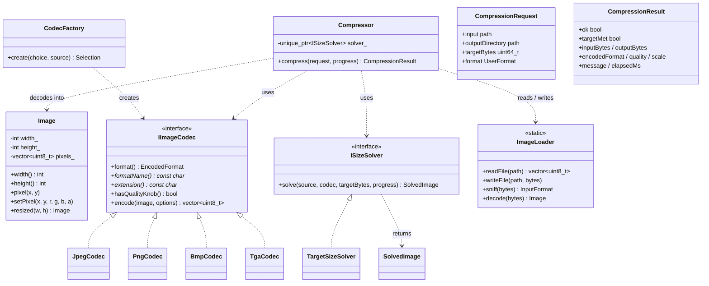

# PressPNG

A small desktop application that compresses an image to a **required target
file size** (for example "make this photo at most 500 KB"). Built with
object-oriented C++17, a native Win32 graphical interface, and no external
runtime dependencies.

Two ways to use it:

- **GUI** (`PressPNG.exe`): pick a file, choose a target size, format, and
  output location, inspect the target preview, then compress.
- **CLI** (`presspng-cli.exe`): same engine for scripts and testing.

## Building on Windows

You only need **CMake ≥ 3.16** and a **C++17 compiler** (Visual Studio
2019+, MinGW-w64, or the kit your Qt Creator already has).

### Option A — Qt Creator

1. *File → Open File or Project…* and select this folder's `CMakeLists.txt`.
2. Pick your desktop kit (any MinGW or MSVC kit works — Qt is not required
   for the current Win32 GUI).
3. Press the green *Run* button. CMake configures, builds, and launches
   `PressPNG.exe`.

### Option B — terminal

```bat
cmake -S . -B build
cmake --build build --config Release
build\Release\PressPNG.exe        (MSVC)
build\PressPNG.exe                (MinGW)
```

Run the test suite with `ctest --test-dir build` (or run
`presspng-tests.exe` directly).

## Using the GUI

1. Choose an image with *Choose image…* or drag it onto the window.
2. Set the maximum output size in KB (1 KB = 1000 bytes) and choose a format.
   Press *Save as…* to choose an output filename and any destination folder;
   leave it blank to save next to the source image.
3. The large preview shows the source or the target-size estimate. Use *Fit*
   or *100%* to change the view. The estimate is recalculated in the
   background when the image, target, or format changes.
4. Press **Compress**. The result view shows the encoded image and the
   destination path; use the nearby actions to open the output folder or
   copy the path.

Output is written next to the input as `<name>_compressed.<ext>`; if that
name already exists, `_compressed2`, `_compressed3`, … is used, so your
original file is never overwritten.

## Command line

```
presspng-cli <image> -s <N>[KB|MB] [-f keep|jpeg|png] [-o <dir>] [-q]
```

Example: `presspng-cli photo.png -s 500KB -f jpeg`

Exit codes: `0` target met, `2` written but target unreachable, `1` error.

## How it works

Everything runs through one facade, `presspng::Compressor`, in a background
thread so the GUI never freezes.

1. **Sniff** the input format from its magic bytes, decode it once with
   `stb_image` into RGBA.
2. **Quality search** (JPEG): binary-search the quality (1–100, about
   seven encodes) for the highest quality whose output still fits the
   budget.
3. **Downscale ladder** (if even quality 1 is too large): estimate
   `scale ≈ sqrt(target / current) × 0.95`, re-encode, up to four rungs.
   Resizing always restarts from the original image, so the result never
   gets blurry from repeated resampling.
4. **PNG**: the encoder picks the smallest colour type (palette / greyscale
   / RGBA) at maximum zlib settings, then the same downscale ladder applies.
5. If the target is simply unreachable, the smallest file found so far is
   written and the result honestly reports `target NOT met`.

If the input is already smaller than the target and you chose *Keep
original*, the bytes are copied unchanged instead of being re-encoded.

## Project structure

```
include/presspng/     public headers (the contracts each part implements)
src/core/             engine: image model, codecs, solver, facade
src/gui/              native Win32 interface + background preview/compression workers
tools/cli.cpp         command line front end
tests/test_core.cpp   59-check test suite (no external framework)
third_party/          stb_image, stb_image_write, lodepng (vendored)
cmake/toolchains/     optional MinGW cross-compile toolchain
```

## OOP design



Key principles used throughout:

- **Encapsulation** — `Image` owns its pixel buffer (RAII), all member
  state is private and accessed through methods.
- **Abstraction / polymorphism** — `IImageCodec` and `ISizeSolver` are
  abstract interfaces; the facade never knows which concrete format or
  search strategy it is running.
- **Open for extension** — a new output format (e.g. WebP) means one new
  `IImageCodec` subclass plus one `CodecFactory` line; a new search
  strategy means one new `ISizeSolver` subclass passed to `Compressor`.
- **Exceptions** — errors are thrown as `CompressionError` deep inside the
  core and caught once at the `Compressor` boundary, so the GUI/CLI always
  receive a plain result object, never an exception.

## Supported formats

| Direction | Formats |
|-----------|---------|
| Read (input) | PNG, JPEG, BMP, TGA, GIF, HDR, PSD, PNM (via `stb_image`) |
| Write (output) | keep original for PNG/JPEG/BMP/TGA, otherwise PNG; forced JPEG or PNG on request |

## Limitations (on purpose, for scope)

- Single file at a time (batch would be a small addition to the CLI).
- No animated GIF or multi-page TIFF output; no WebP/TIFF/HEIC input.
- Targets below ~1 KB are usually unreachable for real photos — the app
  says so instead of pretending.

## Third-party code (vendored, no download needed)

- **stb_image / stb_image_write** — Sean Barrett, MIT or public domain
  (dual licensed), `third_party/stb_image.h`, `stb_image_write.h`.
- **lodepng** — Lode Vandevenne, zlib license, `third_party/lodepng.h/.cpp`.

## Cross-compiling from Linux (optional)

The GUI can be verified from Linux with MinGW-w64:

```sh
cmake -S . -B build-win -DCMAKE_TOOLCHAIN_FILE=cmake/toolchains/mingw-w64-x86_64.cmake
cmake --build build-win
```
